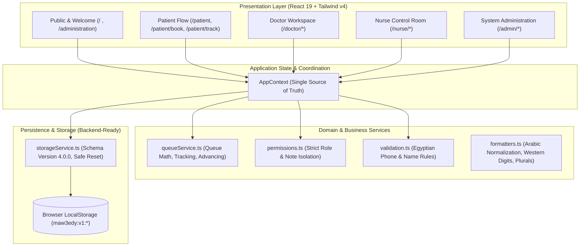
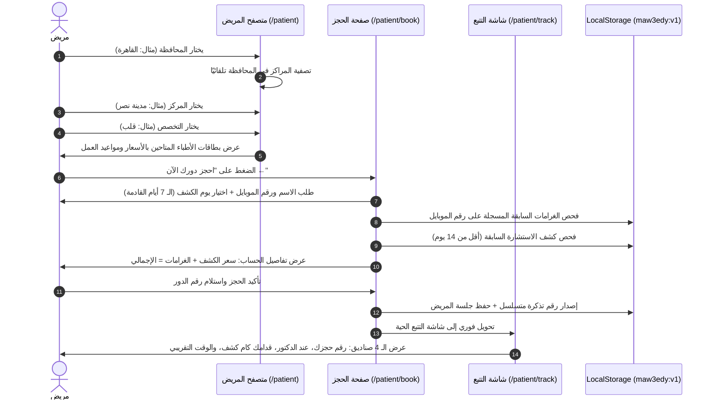
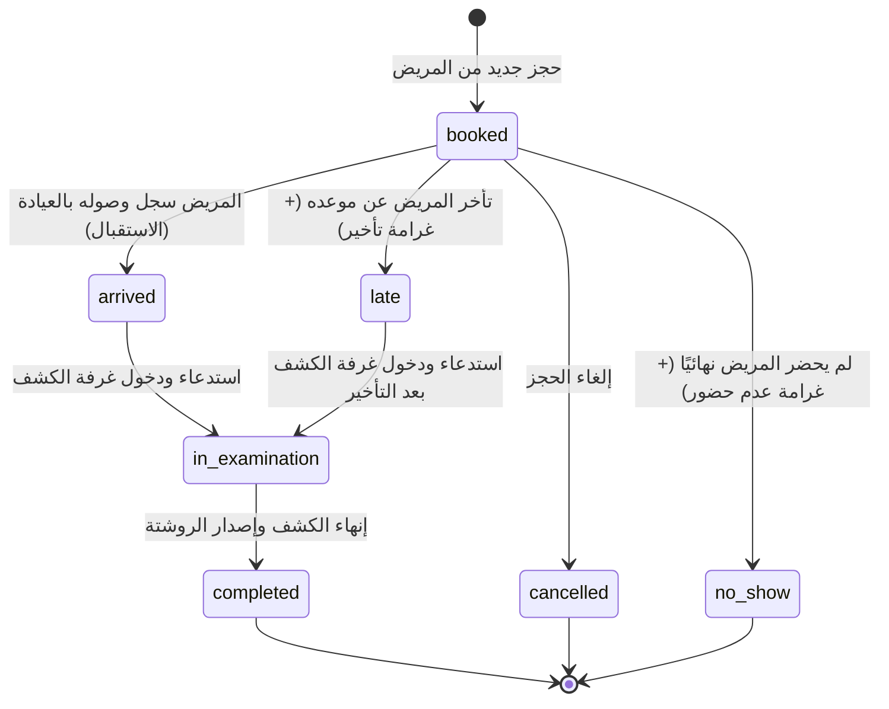

# Maw3edy (موعدي) — Smart Clinic Booking & Live Queue Platform

> منصة عيادات وحجوزات طبية ذكية بنظام الطابور الحي المباشر، وتذاكر الانتظار اللحظية، والروشتة الإلكترونية المعتمدة للمجتمع المصري.

---

## 1. Overview & Stack

**Maw3edy (موعدي)** is a client-side Single Page Application (SPA) engineered specifically for Egyptian clinics, healthcare practitioners, and patients. It eliminates traditional booking friction by offering an **instant public patient journey with zero upfront login or registration**, paired with real-time live queue monitoring, clinical control rooms, and automated penalty management.

### Core Stack Versions

| Technology | Version | Purpose |
| :--- | :--- | :--- |
| **React** | `^19.0.1` | Concurrent UI component library and reactivity |
| **React Router** | `^7.18.5` | Declarative client-side routing and role guards |
| **Vite** | `^8.3.0` | Ultra-fast build engine with native Rolldown |
| **TypeScript** | `^7.0.2` | Static type safety (ES2022 / bundler resolution) |
| **Tailwind CSS** | `^4.3.3` | Tailwind v4 design tokens and utility styles |
| **@fontsource/cairo** | `^5.3.0` | Authentic Cairo Arabic typography (weights 400, 600, 700) |
| **lucide-react** | `^0.546.0` | Accessible SVG medical and interface iconography |
| **Node Test Runner** | `node:test` | Native unit testing suite executed via `tsx` |

### Core Design Principles
- **RTL-First Arabic UI**: Native Right-to-Left layout with Egyptian dialect microcopy and Egyptian phone format (`01X XXXXXXXX`).
- **No Login Until Booking**: Patients search by location, choose from 5 core specialties, pick a doctor and a date, and only provide **Name + Egyptian Phone** to receive an immediate live queue ticket.
- **Glanceable 4-Box Queue Tracking**: Live ticket displaying (1) Your Ticket Number, (2) Doctor's Current Displayed Number, (3) Patients Ahead of You, and (4) Estimated Clock Time.
- **Strict Role Boundaries**: Doctor private clinical notes are strictly isolated and cryptographically filtered in `src/services/permissions.ts`.
- **Backend-Ready Architecture**: 100% of state access flows through `src/services/` and `src/contexts/AppContext.tsx`, making migration to a REST or GraphQL backend seamless.

---

## 2. Architecture & File Tree

### System Architecture



### File Tree

```
d:\health/
├── public/
│   ├── _redirects                     # SPA rewrite rule (/* /index.html 200)
│   ├── favicon.svg                    # Maw3edy Brand SVG Favicon
│   ├── manifest.json                  # Web Application Manifest
│   └── audio/                         # Natural Egyptian voice assets
│       ├── egyptian-salma-scene-*.wav # Dr. Salma voice track (scenes 0-4)
│       └── egyptian-karim-scene-*.wav # Dr. Karim voice track (scenes 0-4)
├── scripts/
│   ├── build_seed_data.cjs            # Master seed data compiler
│   └── generate_seed.cjs              # 27 Governorates & 5 Specialties definitions
├── src/
│   ├── components/
│   │   ├── common/
│   │   │   ├── DashboardCharts.tsx    # Lightweight SVG queue & clinic charts
│   │   │   └── UIPrimitives.tsx       # Buttons, Cards, Badges, Tabs, EmptyStates
│   │   ├── forms/
│   │   │   ├── FormControls.tsx       # Text inputs, phone inputs, date/time pickers
│   │   │   └── SearchableCombobox.tsx # Cascading combobox with mobile bottom sheet
│   │   ├── modals/
│   │   │   └── Overlays.tsx           # Accessible dialogs, drawers, confirmation modals
│   │   └── patient/
│   │       └── PatientExplainerVideo.tsx # Cinema walkthrough player (isolated component)
│   ├── contexts/
│   │   └── AppContext.tsx             # Central state coordinator and action handlers
│   ├── data/
│   │   ├── appointments.ts            # Seed appointments with live queues for today
│   │   ├── clinics.ts                 # 27 Governorates, 5 Specialties, 62 Clinics
│   │   ├── doctors.ts                 # 62 Approved Doctors across all 5 specialties
│   │   ├── fines.ts                   # Seed unpaid late & no-show penalty records
│   │   ├── medicines.ts               # Seed medicine catalog and prescription templates
│   │   ├── notes.ts                   # Doctor private clinical notes (isolated)
│   │   ├── nurses.ts                  # Seed clinic nurse assignments
│   │   ├── patients.ts                # Seed patient profiles
│   │   ├── prescriptions.ts           # Seed electronic prescriptions
│   │   └── reviews.ts                 # Seed patient clinic ratings and reviews
│   ├── layouts/
│   │   └── AppLayouts.tsx             # PublicLayout, DoctorLayout, NurseLayout, AdminLayout
│   ├── pages/
│   │   ├── admin/
│   │   │   └── AdminPages.tsx         # Admin dashboard, doctors, clinics, specialties, reviews
│   │   ├── doctor/
│   │   │   ├── DoctorPages.tsx        # Doctor schedule, visit workflow, prescription builder
│   │   │   └── DoctorSettingsPage.tsx # Queue offset, average exam time, fine policies
│   │   ├── nurse/
│   │   │   └── NursePages.tsx         # Nurse queue control room, walk-in, status manager
│   │   ├── patient/
│   │   │   ├── PatientLocationPage.tsx # Unified single-screen cascading selector + doctors
│   │   │   ├── PatientSpecialtiesPage.tsx # 5 Core specialties view
│   │   │   ├── PatientDoctorsPage.tsx # Filtered doctor cards view
│   │   │   ├── PatientBookingPage.tsx # Name, Phone, 7-day day picker & pricing
│   │   │   ├── PatientTrackingPage.tsx # Glanceable 4-Box live queue tracker
│   │   │   ├── PatientFindBookingPage.tsx # Phone-based ticket lookup & session restore
│   │   │   └── PrescriptionViewPage.tsx # Printable official A4 electronic prescription
│   │   └── public/
│   │       ├── DevStyleGuide.tsx      # Interactive design tokens & UI style guide
│   │       ├── PublicPages.tsx        # Fallback login, register, 404
│   │       └── WelcomeRoleChooserPage.tsx # Home page: 3 cards (Patient, Doctor, Nurse)
│   ├── routes/
│   │   ├── AppRoutes.tsx              # Declarative route hierarchy & legacy aliases
│   │   └── guards/
│   │       └── RequireRole.tsx        # Role-based route guard
│   ├── services/
│   │   ├── permissions.ts             # Cryptographic private note isolation & auth
│   │   ├── queueService.ts            # Core queue algorithms, tracking metrics, advancing
│   │   └── storageService.ts          # Schema versioning, localStorage CRUD, session
│   ├── theme/
│   │   └── tokens.css                 # Dark Teal, Neon Orange, spacing, shadows, fonts
│   ├── types/
│   │   └── index.ts                   # TypeScript interfaces and domain entity types
│   ├── utils/
│   │   ├── formatters.ts              # Arabic normalization, Western numerals, currency
│   │   ├── logic.test.ts              # Automated unit tests (queue, permissions, data)
│   │   └── validation.ts              # Egyptian phone number and name regex validation
│   ├── App.tsx                        # App shell, context provider, router setup
│   ├── index.css                      # Global Tailwind directives, keyframes, safeguards
│   └── main.tsx                       # React 19 application mount point
├── vercel.json                        # Vercel SPA rewrite configuration
└── vite.config.ts                     # Vite bundler configuration
```

---

## 3. Roles & Access Matrix

Maw3edy enforces strict role separation. Patients require **no role and no credentials** to book and track appointments. Hospital staff are protected by `RequireRole`:

| Capability | Patient (Public) | Nurse / Reception | Doctor | Administrator |
| :--- | :---: | :---: | :---: | :---: |
| **Browse Locations & Specialties** | ✅ Full Access | ✅ Read-Only | ✅ Read-Only | ✅ Edit / Manage |
| **Book Appointment (Name + Phone)** | ✅ Full Access | ✅ Walk-In Booking | ❌ | ❌ |
| **View Live Queue Ticket (4 Boxes)** | ✅ Full Access | ✅ Preview | ✅ Preview | ❌ |
| **Advance Queue (Finish & Call Next)**| ❌ | ✅ Full Control | ✅ Full Control | ❌ |
| **Mark Arrived / Late / No-Show** | ❌ | ✅ Full Control | ❌ | ❌ |
| **Apply / Collect Penalties (Fines)** | ❌ | ✅ Collect & Apply | ❌ | ❌ |
| **Write Electronic Prescription** | ❌ | ❌ | ✅ Full Control | ❌ |
| **Access Private Clinical Notes** | ❌ Strictly Blocked | ❌ Strictly Blocked | ✅ Author Doctor Only | ❌ Strictly Blocked |
| **Configure Queue Offset & Fines** | ❌ | ❌ | ✅ Per Doctor | ✅ System Defaults |
| **Manage Clinics & Doctors** | ❌ | ❌ | ❌ | ✅ Full Control |

### Private Notes Isolation Contract (`permissions.ts`)
The function `filterAccessiblePrivateNotes(session, notes, patientId)` guarantees that:
1. Patients, Nurses, and Administrators receive an empty array `[]` when querying private clinical notes.
2. Even if a doctor queries a patient's notes, they only receive notes where `note.doctorId === session.id`. Notes authored by other doctors remain invisible.

---

## 4. Route Map

### 1. Public & Patient Routes (No Login Required)

| Path | Component | Description |
| :--- | :--- | :--- |
| `/` | `WelcomeRoleChooserPage` | 3 Hero Cards: مريض (Instant), ممرض (Login), دكتور (Login), plus discreet Admin link. |
| `/patient` | `PatientLocationPage` | **Unified Patient Flow**: Searchable cascading comboboxes for Governorate + Center + 5 Specialties + Live Doctor Cards. |
| `/patient/specialties` | `PatientSpecialtiesPage` | 5 large specialty cards (Cardiology, Internal Medicine, Orthopedics, OB/GYN, Neurology). |
| `/patient/doctors` | `PatientDoctorsPage` | Filtered doctor cards for selected location and specialty with pricing and days. |
| `/patient/book/:doctorId` | `PatientBookingPage` | Name + Egyptian Phone + 7-day day picker + Price & Unpaid Fines Breakdown. |
| `/patient/track/:appointmentId`| `PatientTrackingPage` | **Glanceable 4-Box Live Queue**: Ticket #, Displayed #, Ahead #, Approx Time, and Status. |
| `/patient/find` | `PatientFindBookingPage` | Phone lookup to restore active or past tickets and inspect pending fines. |
| `/patient/prescriptions/:id` | `PrescriptionViewPage` | Official A4 electronic prescription view with dedicated `@media print` styling. |

### 2. Backward-Compatible Aliases & Redirects

| Path | Target | Reason |
| :--- | :--- | :--- |
| `/patient/queue/:id` | `/patient/track/:id` | Legacy URL alias redirect |
| `/patient/appointments/:id` | `/patient/track/:id` | Legacy deep link alias redirect |
| `/patient/appointments` | `/patient/find` | Redirects to phone-based ticket finder |
| `/patient/records` | `/patient/find` | Redirects to phone-based ticket finder |
| `/patient/profile` | `/patient/find` | Redirects to phone-based ticket finder |
| `/patient/help` | `/patient` | Redirects to patient main flow |
| `/patient/notifications` | `/patient/find` | Redirects to ticket tracker |
| `/onboarding` | `/` | Old 9-step onboarding safely retired |

### 3. Doctor Area (Guarded by `RequireRole="doctor"`)

| Path | Component | Description |
| :--- | :--- | :--- |
| `/doctor` | `DoctorDashboardPage` | Doctor daily summary and queue metrics. |
| `/doctor/schedule` | `DoctorSchedulePage` | Schedule breakdown by time slot and day. |
| `/doctor/visit/:id` | `DoctorVisitWorkflowPage` | 8-step clinical examination workflow. |
| `/doctor/prescription/new`| `PrescriptionBuilderPage` | Electronic prescription builder with drug dosage autocomplete. |
| `/doctor/patients` | `DoctorPatientsPage` | Patient registry and past visit history. |
| `/doctor/patients/:id` | `DoctorPatientProfilePage` | Patient detailed clinical record and prescription list. |
| `/doctor/notes` | `DoctorNotesPage` | Strictly isolated doctor private clinical notes. |
| `/doctor/clinics` | `DoctorClinicsPage` | Doctor clinic branches and daily limits. |
| `/doctor/settings` | `DoctorSettingsPage` | **Doctor Controls**: Queue offset, exam minutes, late/no-show fines, follow-up window. |

### 4. Nurse Area (Guarded by `RequireRole="nurse"`)

| Path | Component | Description |
| :--- | :--- | :--- |
| `/nurse` | `NurseDashboardPage` | Today's clinic attendance overview and quick counters. |
| `/nurse/queue` | `NurseQueuePage` | **Queue Control Room**: Call next, mark arrived, late, no-show, collect fines. |
| `/nurse/walkin` | `NurseWalkInPage` | Instant walk-in patient registration without prior booking. |
| `/nurse/patients` | `NursePatientsPage` | Clinic patient roster and attendance logs. |

### 5. Administrator Area (Guarded by `RequireRole="admin"`)

| Path | Component | Description |
| :--- | :--- | :--- |
| `/admin` | `AdminDashboardPage` | Platform metrics, doctors, clinics, and revenue counters. |
| `/admin/doctors` | `AdminDoctorsPage` | Doctor approval, credentials review, and status toggle. |
| `/admin/clinics` | `AdminClinicsPage` | Clinic location and branch governance. |
| `/admin/nurses` | `AdminNursesPage` | Nurse assignments to clinic branches. |
| `/admin/specialties` | `AdminSpecialtiesPage` | Specialty catalog management. |
| `/admin/locations` | `AdminLocationsPage` | Egyptian Governorates and Centers registry. |
| `/admin/reviews` | `AdminReviewsPage` | Patient review moderation and approval. |

---

## 5. Data Model & Storage Schema

All storage keys are scoped under the `maw3edy:v1:` namespace. On initial load, `storageService.ts` checks `maw3edy:v1:schema_version`. If the version is not `'4.0.0'`, storage is safely refreshed with the new seed dataset without crashing.

```typescript
// Active LocalStorage Keys
export const STORAGE_KEYS = {
  version: 'maw3edy:v1:schema_version',       // '4.0.0'
  session: 'maw3edy:v1:session',               // Current logged-in user session
  patientFlow: 'maw3edy:v1:patient-flow',      // Active in-progress patient choices
  patientSession: 'maw3edy:v1:patient-session',// Active patient identity { phone, name, lastAppointmentId }
  doctors: 'maw3edy:v1:doctors',               // Doctor entities
  patients: 'maw3edy:v1:patients',             // Patient entities
  nurses: 'maw3edy:v1:nurses',                 // Nurse entities
  clinics: 'maw3edy:v1:clinics',               // Clinic entities
  specialties: 'maw3edy:v1:specialties',       // Specialty entities
  locations: 'maw3edy:v1:locations',           // Governorate and City entities
  appointments: 'maw3edy:v1:appointments',     // Appointments with queue tickets
  fines: 'maw3edy:v1:fines',                   // Penalty records (late & no_show)
  prescriptions: 'maw3edy:v1:prescriptions',   // Electronic prescriptions
  templates: 'maw3edy:v1:templates',           // Prescription templates
  medicines: 'maw3edy:v1:medicines',           // Drug catalog
  privateNotes: 'maw3edy:v1:private_notes',   // Doctor private notes
  medicalRecords: 'maw3edy:v1:medical_records',// Clinical history records
  notifications: 'maw3edy:v1:notifications',   // Simulated push notifications
  reviews: 'maw3edy:v1:reviews',               // Clinic reviews
};
```

### Core Entity Schema

```typescript
export interface Appointment {
  id: string;
  bookingNumber: string;         // e.g. '#024'
  ticketNumber: number;          // Sequential integer (1, 2, 3...) per doctor/date
  patientId: string;
  patientName: string;
  patientPhone: string;
  patientAge?: number;
  doctorId: string;
  doctorName: string;
  specialtyAr: string;
  clinicId: string;
  clinicName: string;
  date: string;                  // 'YYYY-MM-DD'
  timeSlot: string;              // e.g. '06:00 م'
  queuePosition: number;         // Current position in active queue
  status: AppointmentStatus;     // 'booked' | 'waiting' | 'arrived' | 'in_examination' | 'completed' | 'late' | 'no_show' | 'cancelled'
  fee: number;                   // Consultation or follow-up fee (EGP)
  type: 'consultation' | 'follow_up';
  isFollowUp?: boolean;
  finesTotal?: number;           // Unpaid penalties included in price
  totalPrice?: number;           // fee + finesTotal
  pricePaid?: boolean;
  symptomsOrReason?: string;
  diagnosis?: string;
  prescriptionId?: string;
  notifyAt?: 3 | 4;             // Send alert when patient is N ahead
  arrivedAt?: string;
  enteredAt?: string;
  completedAt?: string;
  createdAt: string;
  updatedAt: string;
}

export interface Doctor {
  id: string;
  name: string;
  specialtyId: string;
  specialtyAr: string;
  specialtyEn: string;
  titleAr: string;
  qualifications: string[];
  bio: string;
  yearsExperience: number;
  rating: number;
  reviewsCount: number;
  consultationFee: number;
  clinicIds: string[];
  status: 'approved' | 'pending' | 'suspended' | 'rejected';
  phone: string;
  nextAvailableText: string;
  doctorStatus: 'available' | 'in_examination' | 'delayed' | 'off_duty';
  queueOffset: number;           // Default 4 (Displayed # = actualCurrent + queueOffset)
  avgExamMinutes: number;        // Default 10
  lateAction: 'fine' | 'cancel'; // Default 'fine'
  defaultLateFine: number;       // Default 50 EGP
  defaultNoShowFine: number;     // Default 100 EGP
  followUpDays: number;          // Default 14 days
  followUpFee: number;           // Default 0 EGP
  maxPatientsPerDay?: number;    // Default 30 patients
}

export interface Fine {
  id: string;
  patientPhone: string;
  appointmentId?: string;
  doctorId: string;
  type: 'late' | 'no_show';
  amount: number;
  status: 'unpaid' | 'paid';
  note?: string;
  createdAt: string;
  paidAt?: string;
}
```

---

## 6. The Flow (End to End)

### Patient Booking & Live Tracking Flow



### Clinic Queue State Transitions



---

## 7. Business Rules & Worked Examples

### 1. Queue Math (The 4 Boxes)
The patient tracking view (`/patient/track/:id`) derives its metrics from `calculatePatientTrackingMetrics` in `src/services/queueService.ts`:

- **Box 1: رقم حجزك (`ticketNumber`)**: Sequential integer assigned at booking (1, 2, 3...) per doctor for that specific date.
- **Box 2: الدكتور عنده رقم (`displayedNumber`)**:
  $$\text{actualCurrent} = \text{ticket currently in\_examination} \lor \text{last completed ticket} \lor 0$$
  $$\text{displayedNumber} = \text{actualCurrent} + \text{doctor.queueOffset (default 4)}$$
- **Box 3: قدامك كام كشف (`ahead`)**:
  $$\text{ahead} = \max(0, \text{ticketNumber} - \text{displayedNumber})$$
- **Box 4: الوقت التقريبي (`approxClockTime`)**:
  $$\text{waitMinutes} = \text{ahead} \times \text{doctor.avgExamMinutes (default 10)}$$
  $$\text{approxClockTime} = \text{Now} + \text{waitMinutes} \quad (\text{e.g. "حوالي 6:40 م"})$$

#### Worked Example:
- Doctor has `queueOffset = 4` and `avgExamMinutes = 10`.
- Doctor is currently examining Ticket **20** (`actualCurrent = 20`).
- Displayed number at clinic board: $20 + 4 = \mathbf{24}$.
- Patient holds Ticket **28**:
  - Ahead: $28 - 24 = \mathbf{4}$ patients.
  - Wait time: $4 \times 10 = \mathbf{40}$ minutes.
  - If current time is 06:00 PM, approximate time displays **حوالي 06:40 م**.
- If patient holds Ticket **23**:
  - Ahead: $\max(0, 23 - 24) = \mathbf{0}$.
  - System displays alert: **"دورك الآن! يرجى التوجه لغرفة الكشف"**.

### 2. Double Booking Prevention
- In `bookPatientDirect`, before creating a new ticket, the system scans existing appointments for the same doctor, same date, and same normalized phone number (`status !== 'cancelled' && status !== 'no_show'`).
- If a booking already exists, the system reuses the existing ticket, restores the patient session, displays an informative toast ("لديك حجز مؤكد بالفعل عند هذا الطبيب في نفس اليوم"), and navigates to tracking without creating duplicate tickets or charges.

### 3. Capacity Limit Check
- Each doctor has `maxPatientsPerDay` (default 30).
- If total non-cancelled appointments for that doctor on that date reach the capacity limit, the day picker disables that day with label **"اكتمل العدد"**, preventing overbooking.

### 4. Unpaid Fines & Penalty Management
- When a patient is marked `no_show` by reception, a penalty of `defaultNoShowFine` (100 EGP) is recorded in `fines`.
- When a patient is marked `late`, a penalty of `defaultLateFine` (50 EGP) is applied.
- On the next booking with that phone number, unpaid fines are automatically calculated and itemized:
  $$\text{Total Price} = \text{Consultation Fee} + \text{Unpaid Fines}$$
- Reception collects fines at the clinic upon arrival using the `collectPayment` action.

### 5. Follow-Up Window (كشف الاستشارة)
- Doctors configure `followUpDays` (default 14 days) and `followUpFee` (default 0 EGP).
- `checkFollowUpEligibility` checks past completed visits for the same doctor and phone number:
  $$\text{diffDays} = \frac{\text{Booking Date} - \text{Past Visit Date}}{86,400,000}$$
- If $0 \le \text{diffDays} \le 14$, the appointment is categorized as `follow_up`, consultation fee is set to 0 EGP, and a prominent badge appears: **"أنت مؤهل لكشف استشارة / إعادة مجاني! متبقي X يوم"**.

---

## 8. Seed Data Guide

The seed database covers all **27 Egyptian Governorates** and **62 Doctors** across the 5 core specialties.

### 1. The 27 Egyptian Governorates
1. **القاهرة (Cairo)** — 10 Centers (مدينة نصر، مصر الجديدة، المعادي، التجمع الخامس، شبرا، وسط البلد، المقطم، حلوان، الزيتون، الرحاب والشروق).
2. **الجيزة (Giza)** — 9 Centers (الدقي، المهندسين، 6 أكتوبر، الشيخ زايد، الهرم، فيصل، العجوزة، العمرانية، الحوامدية).
3. **الإسكندرية (Alexandria)** — 10 Centers (سموحة، محطة الرمل، سيدي جابر، جليم، لوران، سيدي بشر، ميامي، الإبراهيمية، كفر عبده، العجمي).
4. **القليوبية (Qalyubia)** — 6 Centers (بنها، شبرا الخيمة، طوخ، قليوب، الخانكة، القناطر الخيرية).
5. **الشرقية (Sharqia)** — 7 Centers (الزقازيق، العاشر من رمضان، بلبيس، منيا القمح، فاقوس، أبو كبير، ههيا).
6. **الدقهلية (Dakahlia)** — 7 Centers (المنصورة، طلخا، ميت غمر، السنبلاوين، دكرنس، بلقاس، شربين).
7. **الغربية (Gharbia)** — 6 Centers (طنطا، المحلة الكبرى، كفر الزيات، زفتى، بسيون، السنطة).
8. **المنوفية (Menofia)** — 6 Centers (شبين الكوم، قويسنا، منوف، أشمون، تلا، مدينة السادات).
9. **البحيرة (Beheira)** — 6 Centers (دمنهور، كفر الدوار، إيتاي البارود، كوم حمادة، أبو حمص، حوش عيسى).
10. **كفر الشيخ (Kafr El Sheikh)** — 6 Centers (كفر الشيخ، دسوق، فوه، مطوبس، بيلا، سيدي سالم).
11. **دمياط (Damietta)** — 5 Centers (دمياط، دمياط الجديدة، رأس البر، كفر سعد، فارسكور).
12. **بورسعيد (Port Said)** — 6 Districts (حي الشرق، حي العرب، حي المناخ، حي الضواحي، حي الزهور، بورفؤاد).
13. **الإسماعيلية (Ismailia)** — 5 Centers (الإسماعيلية، فايد، القنطرة غرب، القنطرة شرق، التل الكبير).
14. **السويس (Suez)** — 5 Districts (حي السويس، الأربعين، فيصل، عتاقة، الجناين).
15. **الفيوم (Fayoum)** — 6 Centers (الفيوم، سنورس، إطسا، طامية، إبشواي، يوسف الصديق).
16. **بني سويف (Beni Suef)** — 6 Centers (بني سويف، الواسطى، ناصر، ببا، الفشن، إهناسيا).
17. **المنيا (Minya)** — 6 Centers (المنيا، ملوي، مغاغة، بني مزار، سمالوط، أبو قرقاص).
18. **أسيوط (Asyut)** — 7 Centers (أسيوط، ديروط، القوصية، منفلوط، أبنوب، الفتح، صدفا).
19. **سوهاج (Sohag)** — 7 Centers (سوهاج، أخميم، جرجا، طهطا، البلينا، المراغة، المنشأة).
20. **قنا (Qena)** — 6 Centers (قنا، نجع حمادي، دشنا، قوص، فرشوط، أبو تشت).
21. **الأقصر (Luxor)** — 5 Centers (الأقصر، إسنا، أرمنت، طيبة الجديدة، القرنة).
22. **أسوان (Aswan)** — 5 Centers (أسوان، كوم أمبو، إدفو، نصر النوبة، دراو).
23. **البحر الأحمر (Red Sea)** — 5 Centers (الغردقة، سفاجا، القصير، مرسى علم، رأس غارب).
24. **الوادي الجديد (New Valley)** — 4 Centers (الخارجة، الداخلة، الفرافرة، باريس).
25. **مطروح (Matrouh)** — 6 Centers (مرسى مطروح، الحمام، الضبعة، العلمين ومارينا، سيوة، السلوم).
26. **شمال سيناء (North Sinai)** — 4 Centers (العريش، الشيخ زويد، بئر العبد، رفح).
27. **جنوب سيناء (South Sinai)** — 5 Centers (شرم الشيخ، طور سيناء، دهب، نويبع، رأس سدر).

### 2. Specialty Distribution (62 Doctors)
- **قلب (Cardiology)**: 12 Doctors (`doc-1` to `doc-12`)
- **باطنة (Internal Medicine)**: 14 Doctors (`doc-13` to `doc-26`)
- **عظام (Orthopedics)**: 13 Doctors (`doc-27` to `doc-39`)
- **نسا وتوليد (OB/GYN)**: 12 Doctors (`doc-40` to `doc-51`)
- **مخ وأعصاب (Neurology)**: 11 Doctors (`doc-52` to `doc-62`)

### 3. Intentional Empty State Test Combinations
To verify that the system gracefully handles regions without doctors and renders **"مفيش دكاترة هنا دلوقتي"**:
- **الوادي الجديد**: Has internal medicine (`doc-26`), but **0 doctors in Cardiology, Orthopedics, OB/GYN, and Neurology**.
- **شمال سيناء**: Has orthopedics (`doc-39`), but **0 doctors in Cardiology, Internal Medicine, OB/GYN, and Neurology**.
- **مطروح (سيوة)**: Has 0 doctors.
- **البحر الأحمر (مرسى علم)**: Has 0 doctors.

### 4. Demo Live Queues for Today (`2026-11-05`)
- **د. أحمد محمود (قلب - مدينة نصر)**: Tickets 20 (completed), 21 (in examination), 22 (arrived follow-up), 23 (arrived), 24 (waiting), 25 (booked).
- **د. سارة عبد الرحمن (باطنة - مصر الجديدة)**: Tickets 10 (completed), 11 (in examination), 12 (arrived).
- **د. طارق الشاذلي (عظام - الإسكندرية سموحة)**: Tickets 5 (completed), 6 (in examination).
- **Unpaid Fine Demo Phone**: `01156616135` has a 100 EGP unpaid no-show fine; `01099887766` has 100 EGP fine; `01123456789` has 50 EGP late fine.
- **Follow-up Eligibility Demo Phone**: `01012345678` has a completed appointment on `2026-10-30` (eligible for 0 EGP follow-up).

---

## 9. Known Gaps & Improvement Backlog

1. **Backend Integration**: Replace `localStorage` with a persistent database (PostgreSQL / MongoDB) behind REST or GraphQL APIs.
2. **Real SMS Gateway**: Transition from simulated SMS verification (code `4829`) to an Egyptian SMS gateway (e.g. VictoryLink / Twilio).
3. **Real-Time Push Updates**: Implement WebSockets or Server-Sent Events (SSE) so ticket tracking boxes update in real-time when the receptionist advances the queue, without relying on window `storage` events.
4. **Digital Payment Gateways**: Integrate Egyptian payment gateways (Fawry, Paymob, Vodafone Cash, InstaPay) for online fee and fine settlement.

---

## 10. Backend-Ready Contract

All data reads and writes in the application are strictly isolated inside `src/services/` and `src/contexts/AppContext.tsx`. An external engineering team can implement a backend API by mapping the existing service contracts directly to REST endpoints:

### REST API Endpoint Specification

```http
### Locations & Specialties
GET  /api/v1/locations                    -> Returns list of 27 Governorates & Cities
GET  /api/v1/specialties                  -> Returns the 5 core specialties

### Doctors & Clinics
GET  /api/v1/doctors?gov=&city=&spec=     -> Returns filtered list of approved doctors
GET  /api/v1/doctors/:id                  -> Returns doctor profile, clinic, and working days
PATCH /api/v1/doctors/:id/settings        -> Updates queueOffset, avgExamMinutes, fine policies

### Patient Booking & Live Tracking
POST /api/v1/appointments/direct-book    -> Body: { name, phone, doctorId, date }
                                            Validates capacity, checks double-booking,
                                            calculates follow-up and unpaid fines,
                                            returns created Appointment with ticketNumber
GET  /api/v1/appointments/:id/tracking    -> Returns live 4-box metrics { ticketNumber, displayedNumber, ahead, waitMinutes }
GET  /api/v1/appointments/find?phone=     -> Returns active and past tickets for phone number

### Clinic Control Room (Nurse / Doctor)
POST /api/v1/queue/advance               -> Body: { clinicId, date }
                                            Advances queue (current -> completed, next -> in_examination)
POST /api/v1/queue/checkin-arrived       -> Body: { appointmentId }
POST /api/v1/fines                       -> Body: { patientPhone, doctorId, type, amount, note }
POST /api/v1/fines/collect               -> Body: { appointmentId, fineIds }

### Doctor Clinical Isolation
GET  /api/v1/doctor/private-notes/:patId -> Requires Doctor JWT. Backend validates
                                            WHERE doctor_id = jwt.sub AND patient_id = :patId.
POST /api/v1/prescriptions               -> Creates signed electronic prescription
```

---

## 11. Local Development & Scripts

### Prerequisites
- Node.js `>= 20.0.0`
- npm `>= 10.0.0`

### Available NPM Scripts

```bash
# 1. Start Vite development server with HMR
npm run dev

# 2. Run TypeScript static type checking
npm run lint

# 3. Compile production bundle into dist/
npm run build

# 4. Preview the production build locally
npm run preview

# 5. Execute automated unit test suite
npx tsx --test src/utils/logic.test.ts

# 6. Recompile and regenerate the expanded seed dataset
node scripts/build_seed_data.cjs
```
