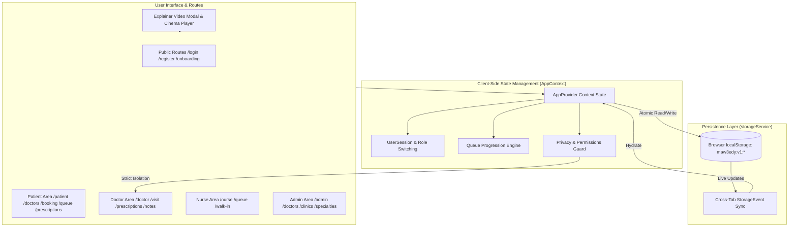

# Maw3edy (موعدي) — Healthcare Clinic Booking & Live Queue Platform

> منصة عيادات وحجوزات طبية ذكية بنظام الطابور اللحظي والروشتة الإلكترونية المعتمدة للمجتمع المصري.

---

## 1. Overview

**Maw3edy (موعدي)** is a client-side Single Page Application (SPA) designed for Egyptian clinics, healthcare professionals, and patients. Built from the ground up for modern desktop and mobile browsers, it delivers an authentic Right-to-Left (RTL) Arabic user experience with localized Egyptian healthcare workflows:

- **Patients**: 9-step interactive onboarding, doctor search with fuzzy Egyptian Arabic search (e.g. "الإسكندرية" matching "اسكندريه"), multi-branch booking with instant queue ticket generation (e.g. `#025`), live queue tracking with distance & estimated waiting times, and printable A4 electronic prescriptions.
- **Interactive Explainer Video**: Cinema-grade interactive walkthrough player with real 24kHz Egyptian human narration (Dr. Salma and Dr. Karim), synchronized word-by-word karaoke subtitles, 5 interactive chapters, and an expandable theatre mode.
- **Doctors**: Daily schedule, active queue overview, 8-step clinical examination workflow, smart electronic prescription builder with drug dosage autocomplete and favorite templates, and strictly isolated private clinical notes.
- **Nurses & Receptionists**: Control room queue management (Start Examination, Finish Examination & Call Next, reorder queue positions, mark arrived / no-show / cancelled), plus walk-in patient registration.
- **Super Administrators**: Governance over doctors, nurses, clinics, specialties, Egyptian governorates/cities, and patient reviews.

---

## 2. Tech Stack & Dependencies

Derived directly from `package.json` and `package-lock.json`:

| Category | Technology | Version | Purpose |
| :--- | :--- | :--- | :--- |
| **Framework** | React | `^19.0.1` | Core UI library |
| **DOM Renderer** | React DOM | `^19.0.1` | Web DOM bindings |
| **Routing** | React Router DOM | `^7.18.5` | Client-side declarative SPA routing & route guards |
| **Build Tool** | Vite | `^8.3.0` | Next-generation bundler with native Rolldown engine |
| **Language** | TypeScript | `^7.0.2` | Static typing in ES2022 / bundler resolution mode |
| **Styling** | Tailwind CSS | `^4.3.3` | Tailwind v4 via `@tailwindcss/vite` |
| **Typography** | `@fontsource/cairo` | `^5.3.0` | Primary Cairo typeface (weights 400, 600, 700) |
| **Icons** | `lucide-react` | `^0.546.0` | Comprehensive accessible SVG icon system |
| **Test Runner** | Node.js Test Runner | `node:test` | Native subtests executed via `tsx` |

---

## 3. Project Structure & Architecture

```
d:\health/
├── public/
│   ├── _redirects                     # SPA rewrite for Netlify / Cloudflare Pages (/* /index.html 200)
│   ├── favicon.svg                    # SVG Brand Favicon
│   ├── manifest.json                  # PWA web app manifest
│   └── audio/                         # Real 24kHz natural Egyptian Arabic WAV narration
│       ├── egyptian-salma-scene-*.wav # Dr. Salma voice track (scenes 0-4)
│       └── egyptian-karim-scene-*.wav # Dr. Karim voice track (scenes 0-4)
├── src/
│   ├── components/
│   │   ├── cards/
│   │   │   ├── ClinicLocationCard.tsx # Branch map preview & address cards
│   │   │   └── DoctorCard.tsx         # Doctor search card with rating and badges
│   │   ├── common/
│   │   │   ├── DashboardCharts.tsx    # Lightweight SVG queue & clinic charts
│   │   │   └── UIPrimitives.tsx       # Buttons, Cards, Badges, Tabs, EmptyStates
│   │   ├── forms/
│   │   │   └── FormControls.tsx       # Accessible text inputs, selects, date/time pickers
│   │   ├── modals/
│   │   │   └── Overlays.tsx           # Accessible dialogs, confirm popups, custom headers
│   │   └── patient/
│   │       └── PatientExplainerVideo.tsx # Explainer video cinema player & modal
│   ├── contexts/
│   │   └── AppContext.tsx             # Root state provider, actions, storage sync
│   ├── data/                          # Comprehensive seed data catalogs
│   │   ├── appointments.ts            # Seed appointments & queue statuses
│   │   ├── clinics.ts                 # Clinics, specialties, governorates, cities
│   │   ├── doctors.ts                 # 24 Egyptian doctors across 10 specialties
│   │   ├── medicines.ts               # Trade and generic medicines & templates
│   │   ├── notes.ts                   # Seed private doctor clinical notes
│   │   ├── nurses.ts                  # Seed nurse accounts
│   │   ├── patients.ts                # Seed patient profiles & medical history
│   │   ├── prescriptions.ts           # Seed electronic prescriptions
│   │   └── reviews.ts                 # Patient reviews, notifications, medical records
│   ├── layouts/
│   │   └── AppLayouts.tsx             # Public, Patient, Doctor, Nurse, Admin layouts
│   ├── pages/
│   │   ├── admin/AdminPages.tsx       # Governance & master data management
│   │   ├── doctor/DoctorPages.tsx     # Doctor dashboard, visit workflow, prescriptions
│   │   ├── nurse/NursePages.tsx       # Control room queue & walk-in registration
│   │   ├── patient/
│   │   │   ├── PatientCareAndRecords.tsx     # Queue tracking, prescriptions, records
│   │   │   └── PatientDiscoveryAndBooking.tsx# Search, booking wizard, confirmation
│   │   └── public/
│   │       ├── DevStyleGuide.tsx      # Living style guide & design tokens preview
│   │       └── PublicPages.tsx        # Login, Register, 9-step Onboarding, 404
│   ├── routes/
│   │   ├── AppRoutes.tsx              # Declarative route configuration
│   │   └── guards/RequireRole.tsx     # Client-side RBAC protection & redirects
│   ├── services/
│   │   ├── mockAuth.ts                # Simulated session persistence & role switching
│   │   ├── notificationService.ts     # In-app event-driven alert generator
│   │   ├── permissions.ts             # Strict doctor private notes isolation
│   │   ├── queueService.ts            # Queue sorting, wait time estimation, FIFO progression
│   │   └── storageService.ts          # localStorage persistence (`maw3edy:v1:*`)
│   ├── theme/
│   │   ├── colors.ts                  # Brand color constants
│   │   └── tokens.css                 # CSS variables (colors, radii, elevations)
│   ├── types/
│   │   └── index.ts                   # Complete TypeScript data model
│   └── utils/
│       ├── formatters.ts              # Arabic plurals, EGP currency, dates, normalized search
│       ├── logic.test.ts              # Unit tests for queue, privacy, validation, formatting
│       └── validation.ts              # Egyptian phone regex & required field checks
├── index.html                         # HTML5 entry with RTL direction & Cairo fonts
├── package.json                       # Scripts and dependencies
├── tsconfig.json                      # Bundler mode TypeScript configuration
├── vercel.json                        # SPA rewrite rule for Vercel
└── vite.config.ts                     # Vite + Tailwind v4 + Rolldown code-splitting
```

---

## 4. Architecture & Data Flow



---

## 5. Prerequisites & Environment Setup

- **Node.js**: `v20.11.0` or higher (verified with Node `v22.22.0`).
- **Package Manager**: `npm` (v10+), `bun`, or `pnpm`.

### Installation

```bash
git clone <repository-url>
cd health
npm install
```

### Local Development Server

```bash
npm run dev
```
The application will start on `http://localhost:3000`.

### Production Build & Preview

```bash
npm run build
npm run preview
```

### Type Checking & Linting

```bash
npm run lint
```
Runs `tsc --noEmit` across all TypeScript files.

### Unit Tests

```bash
npx tsx --test src/utils/logic.test.ts
```
Executes all 8 test suites validating Arabic formatting, normalization, Egyptian phone validation, strict notes privacy, live queue calculations, explainer video integrity, and empty collection handling.

---

## 6. Environment Variables

The project is an entirely client-side Single Page Application. All runtime data is managed via browser storage.

| Variable | Description | Required | Example | Exposure |
| :--- | :--- | :--- | :--- | :--- |
| `GEMINI_API_KEY` | Optional AI Studio runtime key | Optional | `"AIzaSy..."` | Public in browser client |
| `APP_URL` | Base URL of deployed application | Optional | `"https://maw3edy.eg"` | Public in browser client |
| `DISABLE_HMR` | Disables Vite file watcher during CI/agent runs | Optional | `"true"` / `"false"` | Build tool only |

> [!NOTE]
> No private API keys or database secrets should ever be placed in `.env`, as all frontend environment variables are bundled into the client distribution.

---

## 7. Data Layer & Persistence

All records are scoped under the `maw3edy:v1:*` namespace in `localStorage` with in-memory fallback for private browsing mode:

- `maw3edy:v1:session`: Active user session (`id`, `role`, `name`, `phone`, `specialty`).
- `maw3edy:v1:doctors`: Doctor catalog with specialties, fees, and multi-clinic associations.
- `maw3edy:v1:patients`: Patient accounts with medical alert profiles (allergies, chronic conditions).
- `maw3edy:v1:clinics`: Clinic branches with working hours, pricing, delay announcements, and GPS landmarks.
- `maw3edy:v1:appointments`: All appointments with status (`booked`, `waiting`, `arrived`, `in_examination`, `completed`, `cancelled`, `no_show`).
- `maw3edy:v1:prescriptions`: Electronic prescriptions with medicine names, dosages, durations, and meal instructions.
- `maw3edy:v1:private_notes`: Strictly isolated doctor clinical notes.
- `maw3edy:v1:notifications`: In-app event alerts (e.g. "You are next in queue").

### Resetting Demo Data
To reset all data back to the default seed catalog:
1. Open the app and click the user avatar in the top-left corner.
2. Select **إعادة ضبط البيانات التجريبية** (Reset Demo Data).
3. Or execute directly in the browser DevTools console:
```javascript
localStorage.clear();
location.reload();
```

---

## 8. Role-Based Routing Map

| Route Path | Component | Protected Role | Description |
| :--- | :--- | :--- | :--- |
| `/` | `WelcomeLoginPage` | Public | Landing page with direct role selector |
| `/login` | `WelcomeLoginPage` | Public | Login with mobile phone & OTP simulation |
| `/register` | `RegisterPage` | Public | Patient and doctor registration wizard |
| `/onboarding` | `OnboardingPage` | Public | 9-step visual guided tutorial for patients |
| `/dev/ui` | `DevStyleGuidePage` | Public | Design tokens, typography, and primitives showcase |
| `/patient` | `PatientDashboardPage` | `patient` | Active queue status hero, upcoming bookings, quick links |
| `/patient/doctors` | `DoctorSearchPage` | `patient` | Doctor directory with governorate & specialty filters |
| `/patient/doctors/:doctorId` | `DoctorProfilePage` | `patient` | Doctor credentials, clinic branches, pricing, reviews |
| `/patient/booking/:doctorId` | `BookingPage` | `patient` | Multi-branch booking wizard & slot selection |
| `/patient/booking-confirmation/:id` | `BookingConfirmationPage` | `patient` | Confirmation card with booking ticket `#025` |
| `/patient/queue/:id` | `QueueTrackingPage` | `patient` | Real-time queue position radar & wait time |
| `/patient/appointments` | `AppointmentsPage` | `patient` | Past, current, and upcoming appointments |
| `/patient/appointments/:id` | `AppointmentDetailsPage` | `patient` | Detailed appointment status, clinic directions, cancellation |
| `/patient/records` | `MedicalRecordsPage` | `patient` | Medical visit records and diagnostic attachments |
| `/patient/prescriptions` | `PrescriptionsListPage` | `patient` | Electronic prescriptions issued to the patient |
| `/patient/prescriptions/:id` | `PrescriptionViewPage` | `patient` | Printable A4 prescription sheet (`window.print()`) |
| `/patient/notifications` | `NotificationsPage` | `patient` | Simulated push & in-app alerts |
| `/patient/profile` | `PatientProfilePage` | `patient` | Medical safety allergies, phone, and governorate |
| `/patient/help` | `PatientHelpPage` | `patient` | Explainer video, FAQ, restart onboarding |
| `/doctor` | `DoctorDashboardPage` | `doctor` | Today's queue, appointment KPIs, quick action bar |
| `/doctor/clinics` | `DoctorClinicsPage` | `doctor` | Clinic branch management, operating hours, prices |
| `/doctor/schedule` | `DoctorSchedulePage` | `doctor` | Working days, breaks, delay announcements |
| `/doctor/patients` | `DoctorPatientsPage` | `doctor` | Search and filter patients treated by this doctor |
| `/doctor/patients/:id` | `DoctorPatientProfilePage`| `doctor` | Patient medical overview & private clinical notes |
| `/doctor/prescriptions/new` | `PrescriptionBuilderPage` | `doctor` | Smart electronic prescription builder with live preview |
| `/doctor/notes` | `DoctorNotesPage` | `doctor` | Doctor's private clinical notes archive |
| `/doctor/visit/:id` | `DoctorVisitWorkflowPage`| `doctor` | 8-step clinical consultation & prescription workflow |
| `/nurse` | `NurseDashboardPage` | `nurse` | Clinic operational status & waiting room metrics |
| `/nurse/queue` | `NurseQueuePage` | `nurse` | Live queue control room (Finish & Call Next, reorder) |
| `/nurse/walk-in` | `NurseWalkInPage` | `nurse` | Register walk-in arrivals into today's queue |
| `/nurse/patients` | `NursePatientsPage` | `nurse` | Today's patient attendance list |
| `/admin` | `AdminDashboardPage` | `admin` | Platform KPIs across all governorates |
| `/admin/doctors` | `AdminDoctorsPage` | `admin` | Approve, reject, or suspend doctor licenses |
| `/admin/patients` | `AdminPatientsPage` | `admin` | Patient directory (basic info only; no private notes) |
| `/admin/nurses` | `AdminNursesPage` | `admin` | Nurse staff credentials & clinic assignments |
| `/admin/clinics` | `AdminClinicsPage` | `admin` | Master clinic directory & status |
| `/admin/specialties` | `AdminSpecialtiesPage` | `admin` | Medical specialties catalog |
| `/admin/locations` | `AdminLocationsPage` | `admin` | Egyptian governorates and cities hierarchy |
| `/admin/reviews` | `AdminReviewsPage` | `admin` | Patient feedback moderation |
| `/admin/settings` | `AdminSettingsPage` | `admin` | Platform fee settings & system logs |
| `*` | `NotFoundPage` | Public | 404 page with return to safety action |

---

## 9. Core Business Logic & Invariants

1. **Queue Calculation & Progression**:
   - Statuses in queue: `in_examination` (active in room), `arrived` (checked in), `waiting` (waiting in lobby), `booked` (scheduled for today).
   - Only **one** patient may be `in_examination` per clinic at any given time.
   - When the nurse triggers **إنهاء الكشف واستدعاء المريض التالي** (Finish & Call Next), the currently examining patient is set to `completed`, and the next highest priority candidate (`arrived` > `waiting` > `booked`) moves to `in_examination`.
   - Remaining queue positions are automatically re-indexed sequentially (1, 2, 3...).
   - Estimated wait time is calculated dynamically: `patientsAhead * avgExamDurationMin` (with special provision for 4 patients ahead matching the 45-minute clinical average).

2. **Strict Doctor Clinical Notes Privacy**:
   - Implemented in `src/services/permissions.ts` and `src/services/storageService.ts`.
   - Notes written by `doc-1` are only accessible when `session.id === 'doc-1'` and `session.role === 'doctor'`.
   - Neither patients, nurses, super administrators, nor other doctors can ever view or decrypt private notes.

3. **Arabic Normalization & Search**:
   - Implemented in `src/utils/formatters.ts`.
   - Strips tashkeel (diacritics), unifies alef forms (`أ`, `إ`, `آ` → `ا`), unifies `ة` and `ه`, and unifies `ى` and `ي`.
   - Searching for "اسكندريه" seamlessly matches "الإسكندرية".

---

## 10. Explainer Video Cinema Player (`PatientExplainerVideo`)

The explainer video component (`src/components/patient/PatientExplainerVideo.tsx`) provides an immersive, interactive video tour:
- **Enlarged Cinema Box**: Spans up to `1720px` in standard modal mode or `99vw` in full theatre mode with smooth backdrop blur.
- **Dual Egyptian Voice Over**: High-fidelity 24kHz natural Egyptian human speech files recorded for both **Dr. Salma** and **Dr. Karim**.
- **Real-time Karaoke Highlighting**: Spoken words highlight synchronously in bold white with neon-orange pill effects as the narration plays.
- **5 Synchronized Scenes**:
  1. Login & Medical Safety Profile.
  2. Doctor Search & Clinic Comparison.
  3. Appointment Booking & Instant Queue Ticket `#025`.
  4. Live Queue Radar & Turn Approaching Alerts.
  5. Printed E-Prescription & Full Medical History.
- **Theatre Mode Toggle**: Maximizes player canvas for distraction-free viewing.
- **Responsive Compact Hero**: When embedded inline (`compact={true}`), renders a sleek banner with chapter badges that opens the cinema modal on demand.

---

## 11. Deployment Guide

### Vercel Deployment
Preconfigured via root `vercel.json`:
```json
{
  "rewrites": [
    { "source": "/(.*)", "destination": "/index.html" }
  ]
}
```
Deploy command:
```bash
vercel --prod
```

### Netlify / Cloudflare Pages
Preconfigured via `public/_redirects`:
```
/*    /index.html   200
```
Deploy command:
```bash
netlify deploy --prod --dir=dist
```

---

## 12. Troubleshooting & FAQ

- **Q: Why does the video voice stop when switching tabs?**
  *A:* Browsers throttle audio elements in background tabs to conserve battery. The audio will automatically resume when the tab becomes active again.
- **Q: Can I run this with real backend APIs?**
  *A:* Maw3edy is designed as a standalone frontend with modular service abstractions (`storageService.ts`, `mockAuth.ts`). You can easily swap the `readStorage` / `writeStorage` implementations with REST or GraphQL endpoints.
- **Q: How does cross-tab sync work?**
  *A:* The app listens to the native browser `window.addEventListener('storage', ...)` event. When a nurse advances the queue in tab A, the patient's queue radar in tab B immediately updates without page reload.

---

## 13. License

Private prototype for Maw3edy (موعدي) Healthcare Platform. All rights reserved.
